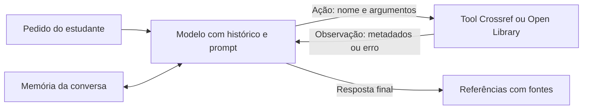

# PesquisaFácil — agente bibliográfico com LangChain

**Autor:** Yuri Henrique Morilla Lima  
**Disciplina:** Desenvolvimento de Data-Driven Apps com Python [26E4_3]  
**Atividade:** DR3 — TP3

O PesquisaFácil ajuda estudantes a iniciar uma pesquisa bibliográfica: busca
artigos no Crossref, livros na Open Library e mantém o contexto dos pedidos na
conversa. O projeto usa Python, LangChain, o padrão ReAct e memória conversacional.

**Situação da validação:** 26 testes automatizados passaram, as duas APIs foram
consultadas com sucesso e a demonstração do grafo e da memória foi executada.
**A geração com Gemini não foi executada nesta entrega**, pois o ambiente não
dispunha de chave. O modo real requer sua chave; a demonstração usa um modelo
roteirizado e snapshots, e não comprova a qualidade das respostas de um LLM.
As evidências e o roteiro de validação real estão em [docs/TESTES.md](docs/TESTES.md).

## 1. Problema e solução

Quem começa um trabalho acadêmico costuma pesquisar em catálogos diferentes,
copiar títulos e identificadores e refazer buscas quando muda o recorte. Isso
dificulta reunir uma lista inicial de referências e manter critérios consistentes.

**Público-alvo:** estudantes de graduação, iniciantes em pesquisa e professores
que orientam o levantamento inicial de referências.

**Objetivo:** centralizar a descoberta de artigos e livros em uma conversa com
fontes verificáveis. O agente seleciona a ferramenta conforme a solicitação,
consulta dados externos e organiza uma resposta com título, autoria, ano e link.
Também interpreta continuações como “agora apenas livros sobre o mesmo tema”.

Funcionalidades: busca por tema, filtro de ano inicial para artigos, duas fontes
bibliográficas, memória por conversa, consulta única, chat e registro de ações.
Não há leitura automática do texto integral, revisão sistemática completa ou
avaliação automática da qualidade científica.

## 2. Execução

Use **Python 3.12**, versão com que o projeto foi testado. Também é possível
instalar com Python 3.13/3.14, mas essas versões não foram validadas nesta entrega.
Os comandos abaixo são executados dentro da pasta do projeto extraído ou clonado.

### Windows — PowerShell

```powershell
python -m venv .venv
.\.venv\Scripts\python.exe -m pip install -r requirements.txt
.\.venv\Scripts\python.exe app.py --demo
```

### Linux e macOS

```bash
python3 -m venv .venv
.venv/bin/python -m pip install -r requirements.txt
.venv/bin/python app.py --demo
```

O arquivo `requirements.txt` fixa as versões usadas na verificação e inclui pytest
e Ruff. As dependências diretas ficam em `pyproject.toml`. Não é preciso ativar o
ambiente virtual; usar o executável completo evita restrições do PowerShell.

### Modo real com Gemini

1. Crie uma chave no [Google AI Studio](https://aistudio.google.com/apikey).
2. Copie `.env.example` para `.env`, na raiz do projeto.
3. Preencha `GOOGLE_API_KEY` no arquivo local. Não publique esse arquivo.
4. Inicie o chat:

```powershell
Copy-Item .env.example .env
# Edite .env antes de executar a próxima linha.
.\.venv\Scripts\python.exe app.py
```

O modelo configurado é `gemini-3.5-flash-lite`, com temperatura 0,2, timeout de
30 segundos e uma repetição de tentativa no provedor. É um modelo com suporte a
function calling, adequado a este fluxo de seleção de ferramentas; o nome pode
ser alterado por `GEMINI_MODEL` no `.env`. Disponibilidade, cotas e eventuais
cobranças dependem da conta Google. Veja a [documentação do modelo](https://aistudio.google.com/docs/models/gemini-3.5-flash-lite)
e a [integração oficial LangChain](https://docs.langchain.com/oss/python/integrations/chat/google_generative_ai).

Exemplo de conversa a executar com sua chave:

```text
Você> Busque 3 artigos sobre aprendizado de máquina em educação desde 2020.
Você> Agora encontre 2 livros sobre o mesmo tema.
Você> Organize os resultados que já encontrou em uma lista de leitura.
Você> /novo
Você> /sair
```

Outras opções:

```powershell
.\.venv\Scripts\python.exe app.py --pergunta "Encontre 2 livros sobre Python"
.\.venv\Scripts\python.exe app.py --rastro
.\.venv\Scripts\python.exe app.py --demo --rastro
.\.venv\Scripts\python.exe app.py --help
```

`/novo` inicia outro contexto; `/sair` encerra. As ações e observações resumidas
aparecem após cada resposta. `--rastro` mostra o retorno completo das ferramentas;
não expõe raciocínio interno do modelo.

### Demonstração sem chave

`--demo` executa dois pedidos fixos: buscar artigos e livros sobre `machine learning`
e depois apenas livros sobre o mesmo tema. Usa o **mesmo grafo LangChain, as mesmas
tools e o mesmo checkpointer** do modo real. Somente o modelo e o transporte HTTP
são substituídos por um roteiro e por snapshots das APIs, coletados em 22/11/2026
(horário de São Paulo). Não aceita perguntas livres e não acessa a rede.

## 3. Ferramentas externas

| Nome | Finalidade e parâmetros | Serviço externo | Retorno |
| --- | --- | --- | --- |
| `buscar_artigos` | Pesquisar tema, limite de 1 a 5 e `ano_minimo` opcional | `https://api.crossref.org/works` | Título, autores, ano, publicação, DOI e link |
| `buscar_livros` | Pesquisar tema e limite de 1 a 5 | `https://openlibrary.org/search.json` | Título, autores, primeira publicação e link do catálogo |

Cada função é registrada com `@tool`, assinatura tipada e descrição para orientar
o LLM. As duas APIs são consultadas via HTTPX e não exigem chave neste projeto.
Os resultados são normalizados em JSON; a integração transmite os esquemas das
tools ao Gemini para que ele escolha nome e argumentos. As APIs e seus parâmetros
estão documentados no [Crossref](https://www.crossref.org/documentation/retrieve-metadata/rest-api/)
e na [Open Library](https://openlibrary.org/dev/docs/api/search).

Exemplo: `buscar_artigos(tema="machine learning", limite=2, ano_minimo=2020)`
envia `query.bibliographic`, `rows=2` e
`filter=type:journal-article,from-pub-date:2020-01-01` ao Crossref.

As consultas têm timeout, identificação de aplicação no User-Agent e limite de
resultados. Entrada inválida, timeout, HTTP 429, indisponibilidade e JSON
inesperado geram mensagens controladas. Dados ausentes permanecem explicitamente
ausentes; o código não cria autores, datas ou links para completar o cadastro.

## 4. ReAct e lógica do agente

O padrão ReAct alterna decisões do modelo com ações no ambiente e observações.
Aqui, o ciclo é implementado por `langchain.agents.create_agent`, sobre LangGraph.
Não se usa uma sequência fixa de chamadas no modo real: o modelo decide consultar
uma ou duas fontes, formular outro pedido ou responder. Consulte a
[documentação de agentes](https://docs.langchain.com/oss/python/langchain/agents)
e o [trabalho original ReAct](https://github.com/ysymyth/ReAct).



1. A CLI valida a entrada e envia a mensagem com um `thread_id`.
2. O checkpointer recupera o histórico dessa conversa.
3. O modelo recebe o objetivo, os esquemas das ferramentas e o histórico.
4. Se produzir `tool_calls`, o grafo executa as ferramentas.
5. O resultado é adicionado como `ToolMessage` e retorna ao modelo.
6. O ciclo termina quando o modelo produz a resposta sem novas chamadas.

O limite é de 24 passos do grafo por pergunta. Ao atingir o limite, a aplicação
informa a falha e inicia outro contexto. O prompt orienta o uso de fontes,
a preservação do tema e o tratamento de metadados como dados não confiáveis.
Essas instruções reduzem erros, mas não garantem a precisão de um LLM.

## 5. Memória conversacional

`InMemorySaver` armazena as mensagens do agente por `thread_id`, incluindo pedidos,
respostas, chamadas e observações. Na próxima pergunta, o mesmo identificador
recupera esse histórico. Isso permite associar “mesmo tema” ao assunto anterior.
A implementação segue a [memória de curto prazo do LangChain](https://docs.langchain.com/oss/python/langchain/short-term-memory).

Uma nova conversa usa outro identificador. Os checkpoints anteriores continuam
na RAM até o processo terminar, mas não são enviados como contexto da conversa
nova. Nada é salvo em banco; fechar o programa perde o histórico. Para conversas
longas, seria necessário resumir ou limitar mensagens. No modo real, o histórico
é enviado ao provedor LLM e os termos de pesquisa são enviados às APIs.

## 6. Casos de uso e resultados observados

| Caso | Critério de validação | Resultado observado |
| --- | --- | --- |
| Encontrar artigos e livros | Consultar ambas as fontes e apresentar referências | Duas APIs reais retornaram 2 registros cada; o grafo simulado executou as duas tools em sequência |
| Refinar “mesmo tema” | Preservar o assunto da pergunta anterior | Histórico entregue ao modelo de teste; demo reutilizou `machine learning` na segunda pergunta |
| Restringir artigos por ano | Enviar filtro temporal ao Crossref | Teste verificou `from-pub-date:2020-01-01`; consulta real filtrada registrada nas evidências |
| Falha ou ausência de dados | Informar o problema e não inventar registros | Testes cobrem vazio, timeout, 429, 503, JSON inválido e metadados ausentes |
| Começar outra conversa | Não recuperar assunto do contexto anterior | Teste com `/novo` e teste de sessão passaram |
| Evitar execução sem fim | Interromper modelo que repete ações | Teste do limite de passos passou e o identificador da sessão foi renovado |

Não foi medida economia de tempo nem taxa de acerto de respostas Gemini.
O detalhamento, os comandos e a distinção entre simulação e execução real estão em
[docs/TESTES.md](docs/TESTES.md). O roteiro com LLM real permanece pendente.

## 7. Testes e qualidade

```powershell
.\.venv\Scripts\python.exe -m pytest -q
.\.venv\Scripts\python.exe -m ruff check .
.\.venv\Scripts\python.exe -m ruff format --check .
.\.venv\Scripts\python.exe -m scripts.validar_servicos
```

Os testes automatizados usam o grafo real com um modelo controlado e transporte
HTTP de teste; não precisam de credenciais nem internet. A verificação de serviços
consulta a rede e grava `docs/evidencias/apis_reais.json`. Resultados ao vivo
podem mudar conforme o catálogo ou a disponibilidade das APIs.

O workflow em `.github/workflows/tests.yml` executa testes, análise estática,
formatação e demonstração em cada push/PR, sem usar chaves.

## 8. Estrutura

```text
app.py                         Entrada executável
pesquisafacil/
  agent.py                     Prompt, Gemini, grafo ReAct e memória
  tools.py                     Validação, consultas e normalização de metadados
  cli.py                       Interface e tratamento de falhas
  demo.py                      Modelo roteirizado e snapshots offline
data/                          Snapshots mínimos usados na demonstração
tests/                         Testes de ferramentas, agente e interface
scripts/validar_servicos.py     Verificação das APIs reais
docs/TESTES.md                 Casos práticos, evidências e limitações
docs/evidencias/               Registros de execução
.env.example                   Configuração de exemplo sem segredo
requirements.txt               Dependências fixadas, incluindo testes
pyproject.toml                 Dependências diretas e ferramentas de qualidade
```

O código separa interface, agente e integração externa, usa nomes descritivos,
tipagem e comentários para decisões que não são óbvias. Chaves são lidas do
ambiente; erros brutos do provedor não são impressos. O repositório ignora `.env`,
caches e ambientes virtuais.

## 9. Reflexão: agente e abordagem manual

| Trabalho | Sem o agente | Com o agente |
| --- | --- | --- |
| Descobrir referências | Abrir cada catálogo e formular cada busca | Expressar o objetivo e deixar o agente escolher as ferramentas |
| Reunir metadados | Copiar títulos, autoria, ano e links individualmente | Receber resultados normalizados das fontes consultadas |
| Refinar o recorte | Repetir tema e critérios em buscas separadas | Continuar a conversa usando o histórico |
| Conferir fontes | Verificar cada registro e o texto integral | A verificação humana continua necessária, com links reunidos |

O principal benefício esperado é reduzir o trabalho de coordenação e repetição
das buscas. As tools agregam dados atuais, enquanto o LLM transforma a solicitação
em ações e organiza a apresentação. As validações locais comprovam a integração
e a memória, mas uma avaliação com estudantes e LLM real seria necessária para
quantificar esse benefício e verificar relevância, fidelidade e usabilidade.

Uma aplicação convencional também poderia consultar as APIs por formulários.
O agente acrescenta flexibilidade para compreender pedidos em linguagem natural,
selecionar fontes e adaptar a próxima ação ao retorno, ao custo de depender do
modelo, da rede, de cotas e da qualidade dos metadados.

## 10. Entrega

O ZIP `Yuri_Henrique_Morilla_Lima_DR3_TP3.ZIP` inclui os arquivos `.py`, o README,
as dependências, os testes e as evidências. Não inclui chaves ou ambiente virtual.
Extraia antes de executar. O repositório deve permanecer público ou acessível
ao avaliador. A submissão no ambiente acadêmico é feita pelo autor.
